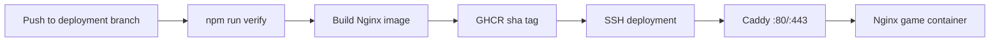

# Production deployment

The production game is the editable `dist/` tree packaged by `Dockerfile` into an Nginx image. GitHub Actions publishes two GHCR tags: an immutable `sha-<commit>` tag used by the VPS and a convenience `latest` tag. The VPS never builds from a mutable checkout.



## Files

- `Dockerfile` and `.dockerignore`: minimal static image and a build context that contains only `dist/` plus the Nginx configuration.
- `docker-compose.yml`: local Docker review on `http://localhost:4173`.
- `docker-compose.prod.yml`: GHCR game image, Caddy edge proxy, persistent certificate state, bounded JSON logs, and restart policies.
- `deploy/nginx.conf`: correct `.mjs`/`.glb` MIME types, short asset revalidation, security headers, gzip, SPA fallback, and `/healthz`.
- `deploy/Caddyfile`: direct HTTP IP access plus automatic HTTPS for `18bro.site` and `www.18bro.site` after DNS propagation.
- `.github/workflows/deploy-production.yml`: verify, publish, SSH update, container wait, and internal/external health checks.

## GitHub configuration

The workflow requires repository secrets `VPS_HOST`, `VPS_USER`, `VPS_SSH_KEY`, and `VPS_KNOWN_HOSTS`. `VPS_SSH_KEY` is the private half of the authorized deployment key. `VPS_KNOWN_HOSTS` pins the VPS ED25519 host key; the workflow never performs an unverified live `ssh-keyscan`. GHCR authentication uses the job-scoped `GITHUB_TOKEN`, so no long-lived registry token is stored.

This project currently deploys from `tarasenkofedor/18bro-web-game`, which owns the feature branch and GHCR package. The authenticated account has pull-only access to `bakedbrioche/18bro-web-game`; after the upstream maintainer merges the pull request, they must add the same four secrets if upstream `main` should become the deployment owner.

## Server layout and operations

The deployment account owns `/opt/18bro`. The workflow uploads only `docker-compose.prod.yml` and `deploy/Caddyfile`, writes the non-secret immutable image URI to `/opt/18bro/.env`, pulls it, and runs:

```sh
docker compose -f /opt/18bro/docker-compose.prod.yml up -d --remove-orphans --wait
curl --fail http://127.0.0.1/healthz
```

Inspect production with:

```sh
cd /opt/18bro
docker compose -f docker-compose.prod.yml ps
docker compose -f docker-compose.prod.yml logs --tail=200 game caddy
```

Rollback by replacing `IMAGE=` in `/opt/18bro/.env` with a previously published `ghcr.io/tarasenkofedor/18bro-web-game:sha-<commit>` tag, then run `docker compose -f docker-compose.prod.yml pull` and `docker compose -f docker-compose.prod.yml up -d --wait`.

## Domain

Keep one apex `A` record for `@` pointed to the VPS IPv4 address and one `CNAME` record for `www` pointed to `18bro.site`. Remove conflicting apex or `www` A/AAAA/CNAME records. Caddy begins certificate issuance automatically when public DNS resolves to the VPS and ports 80 and 443 reach it. Do not add an AAAA record unless the VPS has a configured public IPv6 address.