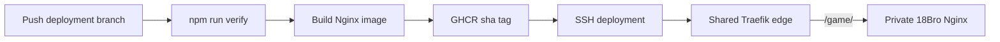

# Production deployment

The production game is the editable `dist/` tree packaged by `Dockerfile` into an Nginx image. GitHub Actions publishes an immutable `sha-<commit>` tag used by the VPS and a convenience `latest` tag. The VPS never builds from a mutable checkout.

A shared Traefik edge owns ports 80 and 443 for this game and future services. 18Bro registers itself through Docker labels at the canonical path `/game/`; Traefik strips `/game` before forwarding to the private Nginx container.



## Files

- `Dockerfile` and `.dockerignore`: minimal static image and a build context containing only `dist/` plus Nginx configuration.
- `docker-compose.yml`: local Docker review at `http://localhost:4173`.
- `docker-compose.proxy.yml`: shared Traefik v3.6 edge, Docker discovery, ports 80/443, HTTP/3, health check, and persistent Let's Encrypt state.
- `docker-compose.prod.yml`: immutable GHCR game image, private `proxy` network membership, and all `/game` HTTP/HTTPS routing labels.
- `deploy/nginx.conf`: correct `.mjs` and `.glb` MIME types, short asset revalidation, security headers, gzip, SPA fallback, and `/healthz`.
- `.github/workflows/deploy-production.yml`: verify, publish, pinned-key SSH update, proxy/game container waits, and internal/external `/game/healthz` checks.

## GitHub configuration

The workflow requires repository secrets `VPS_HOST`, `VPS_USER`, `VPS_SSH_KEY`, and `VPS_KNOWN_HOSTS`. `VPS_SSH_KEY` is the private half of the authorized deployment key. `VPS_KNOWN_HOSTS` pins the VPS ED25519 host key; the workflow never performs an unverified live `ssh-keyscan`. GHCR authentication uses the job-scoped `GITHUB_TOKEN`, so no long-lived registry token is stored.

This project currently deploys from `tarasenkofedor/18bro-web-game`, which owns the feature branch and GHCR package. The authenticated account has pull-only access to `bakedbrioche/18bro-web-game`; after the upstream maintainer merges the pull request, they must add the same four secrets if upstream `main` should become the deployment owner.

## Shared edge and future services

The restricted deployment account owns `/opt/traefik` and `/opt/18bro`. The external Docker network is named `proxy`. Traefik sets `exposedByDefault=false`, so containers are private unless they explicitly opt in with `traefik.enable=true`.

Future app Compose projects should join the existing network:

```yaml
networks:
  proxy:
    external: true
```

They then register their own host or path through Traefik labels. Only the shared proxy publishes host ports; application containers use `expose` on the private network. Do not launch another reverse proxy on ports 80/443.

Traefik mounts the Docker socket read-only for discovery. Treat write access to `docker-compose.proxy.yml` and membership in the `docker` group as administrator-level access.

## Operations

The workflow uploads the two production Compose definitions, writes only the immutable image URI to `/opt/18bro/.env`, pulls the image, and runs both stacks with `--wait`.

Inspect production with:

```sh
cd /opt/traefik
docker compose ps
docker compose logs --tail=200 traefik

cd /opt/18bro
docker compose -f docker-compose.prod.yml ps
docker compose -f docker-compose.prod.yml logs --tail=200 game

curl --fail http://127.0.0.1/game/healthz
```

Rollback by replacing `IMAGE=` in `/opt/18bro/.env` with an earlier `ghcr.io/tarasenkofedor/18bro-web-game:sha-<commit>` tag, then run:

```sh
cd /opt/18bro
docker compose -f docker-compose.prod.yml pull
docker compose -f docker-compose.prod.yml up -d --wait
```

## Domain

The canonical game URL is `https://18bro.site/game/`. Keep one apex `A` record for `@` pointed to the VPS IPv4 address and one `CNAME` record for `www` pointed to `18bro.site`. Remove conflicting apex or `www` A/AAAA/CNAME records. Traefik begins certificate issuance automatically when public DNS resolves to the VPS and ports 80 and 443 reach it. Do not add an AAAA record unless the VPS has a configured public IPv6 address.

Use TTL 300 during cutover so corrections propagate quickly. After HTTPS and both hostnames are stable, raise the TTL to Hostinger's normal 14400-second value. A very low value such as 50 seconds adds DNS traffic without helping normal steady-state operation.

## Live TLS and Dokploy visibility

DNS for `18bro.site` now resolves to `31.97.47.189`. Traefik's ACME resolver has issued the production certificate, and both `https://18bro.site/game/` and `https://18bro.site/game/healthz` complete normal certificate verification. A browser that cached the earlier failed state may need a hard refresh or a new tab; the server-side fix is complete.

Dokploy v0.30.7 is available at the canonical `https://dokploy.18bro.site/` URL with valid HTTPS; `https://dokploy.31-97-47-189.sslip.io/` remains an emergency fallback. Hostinger currently has this record:

- Type: `A`
- Name: `dokploy`
- Value: `31.97.47.189`
- TTL: `300` during the validation window, then `14400` for steady state

The game and shared Traefik edge were created by Docker Compose before Dokploy and are therefore Docker-engine resources rather than Dokploy database projects. They are visible in Dokploy's **Docker** page as Compose projects `18bro` (working directory `/opt/18bro`) and `traefik-edge` (working directory `/opt/traefik`), but they do not increment the Projects/Services cards.

Do not create a second Dokploy-owned copy while GitHub Actions still runs `docker compose` over SSH. To make 18Bro a native Dokploy project, schedule one ownership migration: create/import a Compose service using the existing immutable GHCR image and external `proxy` network, stop the direct-SSH Compose project, then change the GitHub workflow to call Dokploy's deployment hook/API. Only one controller may own the production container. Dokploy should consume the existing shared Traefik edge rather than bind another proxy to ports 80/443.
